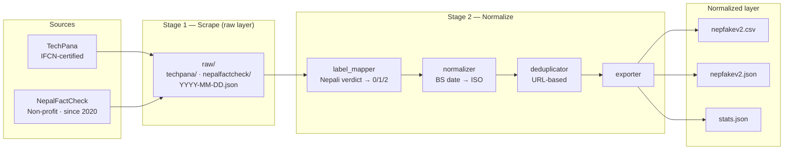

# NepFakeV2 🇳🇵

[](https://github.com/Nandansingh007/NepFakeV2/actions/workflows/weekly_scrape.yml)


**Live, auto-updating data infrastructure for Nepali fact-checking and misinformation research.**

---

## What Is This

NepFakeV2 is primarily a **data collection infrastructure for researchers**. It continuously collects fact-checks published by professional Nepali fact-checkers and exposes them in two layers:

- **Raw layer (`raw/`)** — fact-checks preserved exactly as scraped, stored separately by source and collection date (`raw/<source>/YYYY-MM-DD.json`). Nothing is relabelled, merged, or dropped. Use this layer to apply your own cleaning, deduplication, annotation, or modelling approach. Raw `raw_verdict_text` is what the scraper recorded. Files scraped before 2026-11-23 include the errors listed in [Data corrections](#data-corrections); from 2026-11-23 on, the scraper uses the same verdict rule as the normalized layer (see `label_source`). Use `body_text` as the source of truth.
- **Normalized layer (`data/`)** — a convenient, research-ready representation: verdicts mapped to a shared label set, Bikram Sambat dates converted to ISO, and every record in one consistent schema.

Every record is real, human-verified content that circulated in Nepal — not machine-translated from English-language datasets and not LLM-generated. Publicly available Nepali fake-news datasets typically rely on one of those two shortcuts, which introduce topic-domain and translation-artifact confounds or fail to reflect the misinformation Nepali audiences actually encounter.

New fact-checks are scraped, normalized, and committed to this repo automatically every week.

---

## Getting Started

**Normalized dataset:**

```python
import pandas as pd

df = pd.read_csv(
    "https://raw.githubusercontent.com/Nandansingh007/NepFakeV2/main/data/nepfakev2.csv"
)
print(df[["claim_text", "label_fine", "in_main_benchmark", "split", "source_name"]].head())
```

Also available on Hugging Face: [`Nandan007/NepFakeV2`](https://huggingface.co/datasets/Nandan007/NepFakeV2) (normalized layer only).

**Raw layer** (clone the repo — raw files are published on GitHub only):

```bash
git clone https://github.com/Nandansingh007/NepFakeV2.git
cd NepFakeV2
```

```python
import json, glob
import pandas as pd

rows = []
for path in sorted(glob.glob("raw/*/*.json")):
    if path.endswith("stats_raw.json"):
        continue
    source, collected = path.split("/")[-2], path.split("/")[-1][:-5]
    for rec in json.load(open(path, encoding="utf-8")):
        rows.append({**rec, "_source": source, "_collected_on": collected})

raw = pd.DataFrame(rows)
print(raw.columns.tolist())
print(raw["raw_verdict_text"].value_counts())
```

Raw verdicts are kept in the original Nepali (e.g. भ्रामक, मिथ्या, सही, अपुष्ट) so you can define your own label mapping.

---

## Labels (normalized layer)

| Label | Name | Description |
|-------|------|-------------|
| 0 | REAL | Verified factual — confirmed by fact-checkers |
| 1 | FALSE_MISLEADING | Debunked — false or misleading content |
| 2 | UNVERIFIED | Cannot be confirmed or denied |

**Fine labels (`label_fine`, schema 2.0).** The coarse label above is kept unchanged. `label_fine` splits FALSE_MISLEADING:

| `label_fine` | Nepali verdict | Meaning | Coarse label |
|---|---|---|---|
| FALSE | मिथ्या (also झुटो, असत्य, "दाबी गलत हो") | The claim is fabricated or untrue | 1 |
| MISLEADING | भ्रामक (also भ्रम, "गलत सन्दर्भ / अर्थ / व्याख्या") | Real content in a wrong context, or a distorted claim | 1 |
| TRUE | सही (also साँचो, सत्य) | The claim is accurate | 0 |
| UNVERIFIED | अपुष्ट | Could not be confirmed or refuted | 2 |

### What the data supports

Every row is one professional fact-check of a claim that circulated in Nepal. Each row has the claim, the article's evidence, the verdict, who made the claim (when the outlet names them), the outlet, the URL and the date. The data can be used for:

- **Falsity type: FALSE vs MISLEADING.** Rows with `in_main_benchmark == True`: fine label FALSE or MISLEADING, verdict read from the article text (or hand-checked), article in Nepali. Badge-only rows (`label_source == "stored"`) and the English rows are left out. A TechPana conclusion that names both मिथ्या and भ्रामक takes the verdict of its sentence about the claim (`conclusion_claim`); if that names both too, it is MISLEADING (`conclusion_mixed`, in the benchmark; drop these rows with a filter on `label_source` if you want only single-verdict rows). Almost every row is a debunk (TRUE 17, UNVERIFIED 26), so this asks *how* a claim is wrong, not *whether* it is.
- **Claim + evidence.** `claim_text` with `evidence_text` (the article's own reasoning, verdict sentences removed).
- **Claim only.** `claim_text` alone. On FALSE vs MISLEADING this is much harder: the difference usually lies in what the media really is (old, edited, from elsewhere), which the claim does not say.
- **Claimant.** `claimant`: who made the claim, as the fact-checker names it (NepalFactCheck rows).
- **Explanations.** `conclusion_text` and the fact-checker's "तथ्य" line state the verdict and why. Use them as targets for explanation generation, never as model inputs for classification.

**The official benchmark task, split and metric are not fixed yet.** They will be fixed at the v2.0 freeze and written here and in [VERSIONING.md](VERSIONING.md). Until then, `in_main_benchmark`, `split` and `split_random` are provisional, and no score on them is official.

**Model inputs: `claim_text` and `evidence_text` only.** `headline` and `conclusion_text` state the verdict. A word counter that counts मिथ्या vs भ्रामक scored 90% on the old `evidence_text`; on the 2.0 columns it scores the majority baseline (62%). If you use the provisional splits, report both: `split` (time) and `split_random` (random by claim group). The FALSE/MISLEADING balance changes a lot between years (train 61% FALSE, test 22% FALSE), so the time split alone mostly measures that shift.

```python
main = df[df["in_main_benchmark"]]               # provisional until the v2.0 freeze
train = main[main["split"] == "train"]          # or split_random
X, y = train["claim_text"] + " " + train["evidence_text"], train["label_fine"]
```

See [Limitations](#limitations) on label imbalance.

---

## Sources

| Source | Type | Language | Coverage |
|--------|------|----------|----------|
| [TechPana](https://techpana.com/factcheck/) | Fact-checker following the IFCN code of principles | Nepali | Feb 2025 → present (one earlier article, Jul 2024) |
| [NepalFactCheck](https://nepalfactcheck.org) | IFCN-certified fact-checker run by CMR-Nepal | Nepali | Mar 2020 → present |

---

### Data contract

- **Raw** (`raw/`): a faithful copy of each fetch, never edited afterwards.
- **Normalized** (`data/nepfakev2.csv`): every row passes the written rules, and weaker rows are flagged (`verified`, `label_source`, `snapshot_conflict`).
- **Excluded** (`data/excluded.csv`): every article left out, with a reason.
- **Benchmark** (`in_main_benchmark`): a subset by a written rule, and every other row says why in `benchmark_exclusion_reason`.
- **Count:** unique articles in raw = normalized + excluded, checked by a test on every run.

Details and the exact reasons: [DATASHEET.md](DATASHEET.md), "Data contract".

## Schema (normalized layer)

| Field | Type | Description |
|-------|------|-------------|
| `example_id` | str | Stable ID from the URL: `NF2_tp_<article number>` (TechPana) or `NF2_nfc_<10 hex>` (NepalFactCheck). Old IDs (`NF2_YYYYMMDD_NNNN`): `data/id_map_v1_to_v2.csv` |
| `claim_text` | str | The claim being checked, taken from the article: NepalFactCheck's summary box (`दावी :`), a `के … हो?` headline, or the post's caption quoted in TechPana's `दाबी` section; hand-written where the rules fail. Verdict words removed. See `claim_source` |
| `claim_source` | str | Where `claim_text` came from: `claim_box` (NFC summary box), `headline_question` (NFC `के … हो?` headline), `claim_caption` (TechPana: the post's quoted caption), `hand_checked` (`data_validation/claims_reference.csv`), or the fallbacks `lead_quote`, `lead`, `claim_section`, `headline` |
| `claimant` | str | Who made the claim, as the fact-checker names it (NFC `दावीकर्ता`, 74% of NFC benchmark rows; TechPana only from the hand check). Empty if not given |
| `claim_platform` | str | Where the claim spread (several values are separated by a vertical bar): `facebook`, `tiktok`, `x`, `youtube`, `instagram`, `messaging`, `news_media`. From the claimant line and TechPana's `दाबी` section, or the hand check. Empty = the article names none |
| `headline` | str | The fact-checker's headline. **Usually states the verdict: not a model input** |
| `verdict_label` | int | 0 / 1 / 2 (coarse label) |
| `verdict_label_text` | str | REAL / FALSE_MISLEADING / UNVERIFIED |
| `label_fine` | str | FALSE / MISLEADING / TRUE / UNVERIFIED (see Labels) |
| `label_source` | str | Where the verdict was read: `nfc_header`, `conclusion`, `conclusion_claim`, `conclusion_mixed`, `summary`, `stored` (scraper's badge only), `hand_checked` (a person read the article) |
| `verified` | str | `gold`: a person checked the label (`label_source == "hand_checked"`). `silver`: read from the article by rules only. Score gold rows with `python -m pipeline.evaluate … --gold` |
| `snapshot_conflict` | bool | `True` if another snapshot of the same article had a different `label_fine`. The copy used is chosen by a fixed rule (DATASHEET, "Redundancy") and used whole |
| `snapshot_other_label` | str | `label_fine` of the other snapshot(s), several separated by a vertical bar; empty if none |
| `snapshot_source` | str | `live`: the copy comes from `raw/<source>/` (latest full re-scrape and later weekly runs). `archive`: from `raw/archive/`, used only when no live copy is usable (live copy has no verdict, or the article was not fetched again) |
| `in_main_benchmark` | bool | True if the row belongs to the main FALSE-vs-MISLEADING task |
| `benchmark_exclusion_reason` | str | Why the row is not in the benchmark, empty if it is: `label_<LABEL>`, `label_source_stored`, `language_en`, `page_cut` (several separated by a vertical bar) |
| `evidence_text` | str | Article body without header, conclusion (TechPana `निष्कर्ष`, NepalFactCheck's `दावी / दावीकर्ता / तथ्य` summary box), footer, and without any sentence that states the verdict. Links removed (they are in `external_evidence_urls`) and the outlet's own name replaced by `[OUTLET]` |
| `conclusion_text` | str | The fact-checker's conclusion. **States the verdict: not a model input** |
| `external_evidence_urls` | str | Links in the article, `" \| "`-separated, without share buttons and the outlet's own pages |
| `source_name` | str | techpana / nepalfactcheck |
| `source_type` | str | fact_checker |
| `source_url` | str | Original article URL |
| `date_published` | str | ISO date YYYY-MM-DD |
| `date_precision` | str | day / month / year (a year-only date is stored as YYYY-01-01) |
| `date_scraped` | str | Date of the snapshot this row was built from |
| `language` | str | `ne` or `en` (share of Devanagari letters) |
| `is_native_nepali` | bool | `language == "ne"` |
| `label_basis` | str | fact_checker_verdict |
| `topic_category` | str | Keyword heuristic: politics / health / technology / society / environment / economy / other |
| `annotator_notes` | str | Edge-case flags, empty if clean |
| `claim_group_id` | str | Rows about the same claim (often both outlets checking one viral post) share this ID |
| `split` | str | Time split: train / dev / test (`new` for rows added after the freeze) |
| `split_random` | str | Random control split by claim group |
| `schema_version` | str | 2.0 |

---

## Pipeline



> GitHub Actions runs this pipeline weekly. Only articles published since the last run are fetched. Outputs are auto-committed to this repo and pushed to Hugging Face after every run.

---

<!-- STATS_START -->
## Dataset Statistics

| | |
|---|---|
| 🗃 Raw articles scraped (unique URLs) | **972** (1931 stored snapshots) |
| ✅ Normalized examples | **945** |
| 📅 Date range | 2020-03-13 → 2026-11-26 |
| 🕒 Last updated | 2026-11-28 11:49 UTC |

**Last run:** 2026-11-28 &nbsp;|&nbsp; ✓ TechPana: +4 new (275 fetched) &nbsp;|&nbsp; ✓ NepalFactCheck: +2 new (690 fetched)
> **27 articles left out** (explainer 22, not_a_factcheck 4, verdict_unmappable 1). Each is listed with its reason in `data/excluded.csv`.

### Label Distribution (normalized)

| Label | Count | % |
|-------|------:|--:|
| REAL                 |    16 |   1.7% |
| FALSE_MISLEADING     |   902 |  95.4% |
| UNVERIFIED           |    27 |   2.9% |
| UNKNOWN              |     0 |   0.0% |

### Fine Labels (normalized, `label_fine`)

| Source | FALSE | MISLEADING | TRUE | UNVERIFIED |
|--------|------:|-----------:|-----:|-----------:|
| NepalFactCheck   |  274 |  364 |    8 |   22 |
| TechPana         |   79 |  185 |    8 |    5 |

Main benchmark (FALSE vs MISLEADING, `in_main_benchmark`): **868** rows (338 FALSE, 530 MISLEADING)

Splits (provisional until the freeze): time `split` test 395, train 358, dev 192; random control `split_random` train 668, test 176, dev 101

### Source Breakdown (raw)

| Source | Articles | Verdict profile |
|--------|----------:|-----------------|
| TechPana         |  282 | भ्रामक: 62%  मिथ्या: 23%  unmapped: 10%  सही: 3%  अपुष्ट: 2%  ⚠ 27 unmapped |
| NepalFactCheck   |  690 | भ्रामक: 53%  मिथ्या: 40%  सही: 4%  अपुष्ट: 3% |

Nepali script coverage: **99.3%**
<!-- STATS_END -->

## Data corrections

**2026-11-23 (schema 2.0).** No verdict label changed. What changed: stable URL-based IDs (old ones in `data/id_map_v1_to_v2.csv`); `claim_text` is now the claim from the article, not the headline; `evidence_text` no longer contains the verdict; new columns `label_fine`, `in_main_benchmark`, `claim_source`, `headline`, `conclusion_text`, `date_precision`, `date_scraped`, `language`, `claim_group_id`, `split_random`; the always-empty `evidence_sentences` and `source_outlet` are removed; left-out articles are listed in `data/excluded.csv`. Full list: [CHANGELOG.md](CHANGELOG.md) and [DATASHEET.md](DATASHEET.md).

**2026-11-22 (schema 1.1, commit 50f5c7f).** The TechPana scraper read the image badge before the fact-checker's conclusion, while the normalizer did the reverse, so 54 raw TechPana verdicts disagreed with the dataset (all already corrected in `data/`). Both now use one rule: the conclusion box, then the lead summary, then the stored badge. A new `label_source` column records which one was used.

| Change | Affected | Effect |
|---|---|---|
| Verdict read from the lead summary when the conclusion names no single verdict | 16 TechPana rows | 3 labels changed (2025 rows where the old badge contradicted the text): 151229 FALSE_MISLEADING → UNVERIFIED; 150099 and 149828 UNVERIFIED → FALSE_MISLEADING |
| New column `label_source` | all rows | `nfc_header` 662, `conclusion` 191, `stored` 46, `conclusion_mixed` 23, `summary` 16 |
| "गलत" (wrong) now counts as misleading, not false | TechPana conclusions | No change to the 3-class label (both are FALSE_MISLEADING) |
| `stats.json` schema version was hardcoded as 1.0 | stats.json | Now taken from the code (1.1) |

**2026-11-23 (schema 2.0).** No verdict label changed. What changed: stable URL-based IDs (old ones in `data/id_map_v1_to_v2.csv`); `claim_text` is now the claim from the article, not the headline; `evidence_text` no longer contains the verdict; new columns `label_fine`, `in_main_benchmark`, `claim_source`, `headline`, `conclusion_text`, `date_precision`, `date_scraped`, `language`, `claim_group_id`, `split_random`; the always-empty `evidence_sentences` and `source_outlet` are removed; left-out articles are listed in `data/excluded.csv`; one NepalFactCheck article whose tag line carries both तथ्यजाँच (fact-check) and एक्सप्लेनर (explainer) is now kept with its verdict; the explainer rule had dropped it from the 2026-11-23 weekly data (`ai-generated-false-videos-of-prime-minister-balen-and-other-top-officials`, FALSE). Full list: [CHANGELOG.md](CHANGELOG.md) and [DATASHEET.md](DATASHEET.md).

**2026-10-11 (commits 770f96f, 8a37091).** An audit against each article's own text found five scraper errors. The raw layer is unchanged; the normalized layer now rebuilds labels from the saved article text.

| Problem | Affected | Correction |
|---|---|---|
| NepalFactCheck verdict read from a sidebar article's icon | 39 of 677 (33 false/misleading stored as REAL) | Verdict from the article's own header tag |
| TechPana verdict read from any image; conclusion cut off by an in-article related-news box | 8 of 271 (7 REAL, 1 UNVERIFIED stored as FALSE_MISLEADING) | Verdict from the article's own conclusion, negations handled |
| TechPana date taken from the sidebar | 145 of 275 | Date from the article's own date line |
| NepalFactCheck explainers (एक्सप्लेनर) stored as REAL | 17 | Excluded: they explain a topic and check no claim |
| TechPana non-fact-check articles | 4 | Excluded by the fact-check filter |

Normalized examples went from 952 to 931 on the same raw data. If you used an earlier snapshot, re-download.

---

## Limitations

- **Label imbalance** — fact-checkers publish mostly debunks by design, so 90%+ of normalized examples are FALSE_MISLEADING. This reflects the source distribution, not a collection error. Researchers needing label balance can supplement with a verified news source using the provided scraper base class.
- **`claim_text`**: on the 830 benchmark rows, 524 come from NepalFactCheck's summary box and 49 from its `के … हो?` headlines. The other 257 (all TechPana rows, mostly 2020 NepalFactCheck rows) are being checked by hand (`python -m pipeline.claims_reference sheet`, then `data_validation/claims_reference.csv`). Until that is done, treat `claim_caption` and the fallback sources as weaker. A 50-claim blind check per `claim_source` follows.
- **Claim groups are a heuristic** (shared rare words within 30 days). The known cross-outlet pairs are grouped; some unrelated election claims are grouped too (one group has 38 rows), which is the safe direction.
- **Splits are provisional** until they are frozen in `data/splits_v2.0.csv` (after the full re-scrape). Do not report numbers on provisional splits.
- **Cross-source duplicates are kept intentionally** — the same claim may be fact-checked independently by both sources. These records are preserved as separate observations with their original provenance, since they represent independent verifications. Deduplication is URL-based (the newest snapshot of a URL wins, unless the newer copy lost its verdict, its claim or most of its text; then the older one is kept). Rows about the same claim share `claim_group_id`, and the splits never separate a group.
- **TechPana uses Cloudflare** — TechPana blocks datacenter IPs and is scraped via FlareSolverr in CI. See `.github/workflows/weekly_scrape.yml`.

---

## Versions and how to report results

- **Live data** (`default` config, `main`): grows every week. Every weekly push is tagged `run-YYYY-MM-DD` here and on GitHub. Do not report benchmark scores on it.
- **Benchmark `v2.0`**: frozen splits, released once (planned after the full re-scrape and the hand check). After the release: `load_dataset("Nandan007/NepFakeV2", "benchmark-v2.0", revision="v2.0")`, plus `benchmark-v2.0-random` for the control split. Until then those configs do not exist.
- **Every published score names the release and the split**, e.g. "NepFakeV2 v2.0, time test split". The official task, split and metric are fixed at the v2.0 freeze (see [What the data supports](#what-the-data-supports)); always report the majority baseline next to a score. Scorer: `python -m pipeline.evaluate predictions.csv`.
- **Cite the tag** (`v2.0`, or a `run-` tag for live data), not a download date.
- Rows added after the freeze have `split = "new"`. You may split them as you like; we recommend splitting by `claim_group_id`, dropping new rows whose `claim_group_id` is also in v2.0 if you train on v2.0, and reporting the run tag and the `date_published` range you used.
- When a new version comes out, and everything above in detail: [VERSIONING.md](VERSIONING.md).

## Personal and sensitive information

Rows quote public fact-checks. They name public figures (mostly politicians) and link to the social-media posts and accounts that spread a claim, some of them private people. The `claimant` column repeats the names the fact-checker gives for who spread a claim (pages, accounts, sometimes private users). Do not use the data to profile or target anyone named or linked. To have a row removed, open an issue on GitHub with its `source_url`.

---

## Citation

Cite the release tag you used (`v2.0`), not the download date. Metadata: [CITATION.cff](CITATION.cff).

```bibtex
@dataset{singh2026nepfakev2,
  author    = {Singh, Nandan},
  title     = {NepFakeV2: A Live, auto-updating Dataset for Nepali Misinformation Detection},
  version   = {v2.0},
  year      = {2026},
  publisher = {GitHub},
  url       = {https://github.com/Nandansingh007/NepFakeV2},
  note      = {Benchmark release v2.0. For live data, give the run-YYYY-MM-DD tag instead.}
}
```

---

## License

- **Data** (`data/`, `raw/`): [CC BY 4.0](https://creativecommons.org/licenses/by/4.0/)
- **Code**: [MIT](LICENSE)

The CC BY 4.0 licence covers the labels, the metadata and the dataset's structure. The article text in `claim_text`, `evidence_text`, `headline` and `conclusion_text` is quoted from TechPana and NepalFactCheck, who keep its copyright; every row links to the original article. Rights holders can ask for removal through a GitHub issue.

---

*Built by [Nandan Singh](https://github.com/Nandansingh007) · 2026*
